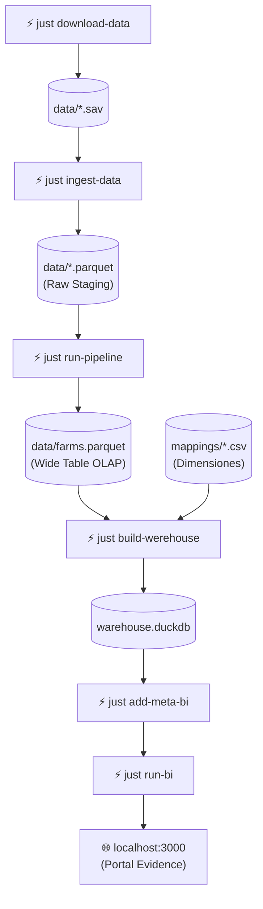

# Proyecto Integrador III: Data Analytics Ecosystem (CENAGRO 2011)

Este repositorio contiene una solución de ingeniería de datos integral para procesar, modelar y visualizar los resultados del **IV Censo Nacional Agropecuario de Nicaragua (CENAGRO 2011)**. El proyecto implementa una arquitectura de **Modern Data Stack** local, diseñada para maximizar la eficiencia computacional en hardware limitado.

## 🌐 Despliegue Público
La versión compilada de este informe se sirve estáticamente al público en la siguiente dirección:
**[cenagro-analytics-ni.netlify.app](https://cenagro-analytics-ni.netlify.app)**

## 🗄️ Dataset de Investigación (Open Access)
Los microdatos transformados, normalizados y anonimizados utilizados en esta investigación están disponibles públicamente para fines académicos y científicos.

* **DOI:** [10.5281/zenodo.20652059](https://zenodo.org/records/20652059)
* **Formato:** Parquet (Optimizado para lectura columnar/OLAP).
* **Licencia:** CC-BY 4.0 (Atribución Internacional).
* **Descripción:** Dataset resultante del pipeline ETL, que contiene los registros del CENAGRO 2011 tras el proceso de *downcasting*, tipificación estricta y desnormalización de tablas de hechos (Facts) y dimensiones (Dims).

> **Nota para investigadores:** Este dataset se distribuye en formato Parquet para garantizar la compatibilidad con motores analíticos modernos (DuckDB, Apache Arrow, Polars). Se recomienda consultar la documentación de la capa semántica en la sección de `/pages` para comprender el diccionario de variables y matrices de indicadores (One-Hot Encoding) aplicadas.

## 🚀 Capacidades del Sistema

*   **Procesamiento de Alto Rendimiento:** Motor ETL desarrollado en **Rust** utilizando **Apache DataFusion** para transformaciones vectorizadas y multihilo sobre memoria columnar **Arrow**.
*   **Arquitectura Desacoplada:** Separación estricta entre la ingesta (Python), transformación pesada (Rust), orquestación (Just), almacenamiento (DuckDB) y visualización (Evidence.dev).
*   **Análisis OLAP Eficiente:** Uso de **DuckDB** como motor analítico *in-process*, permitiendo consultas complejas sobre archivos Parquet con un consumo mínimo de memoria.
*   **Capa de Presentación como Código:** Portal de BI estático generado mediante **Evidence.dev**, donde los gráficos y métricas se definen mediante Markdown y SQL.
*   **Infraestructura Atómica:** Despliegue contenerizado mediante **Podman** (daemonless/rootless), garantizando la reproducibilidad del entorno sobre sistemas operativos inmutables como **Aurora Fedora**.

---

## 📂 Estructura del Repositorio

| Directorio | Propósito |
| :--- | :--- |
| `etl/` | Código fuente en **Rust** para el pipeline de transformación y normalización de datos. |
| `analytics/` | Portal de visualización en **Evidence.dev**, incluyendo el marco teórico y análisis descriptivos. |
| `infra/` | Definiciones de contenedores (**Containerfiles**) para el compilador, transformador y servidor de BI. |
| `pipes/` | Scripts de soporte en Python para la ingesta inicial de archivos SPSS (`.sav`) a Parquet. |
| `mappings/` | Diccionarios maestros en CSV para la tipificación de variables geográficas y categóricas. |
| `sql/` | Scripts DDL/DML para la construcción del warehouse y carga de tablas en **DuckDB**. |

---

## Requisitos de Sistema

Este proyecto asume un entorno de desarrollo profesional en Linux (preferiblemente distribuciones basadas en **Fedora Aurora** o **Bazzite**) y requiere las siguientes herramientas instaladas para la ejecución, orquestación y edición del pipeline:

### Herramientas de Ejecución Obligatorias
*   **Podman**: Motor de contenedores *daemonless* y *rootless* utilizado para aislar el entorno de compilación de Rust y el servidor de BI.
*   **Just**: Orquestador de comandos (`justfile`) que automatiza el flujo de trabajo entre los diferentes componentes del sistema.
*   **DuckDB**: Motor analítico OLAP utilizado para la construcción del warehouse y la ejecución de consultas sobre archivos Parquet.

### Entorno de Desarrollo (IDE)
*   **Zellij**: Multiplexor de terminal utilizado para gestionar el layout del espacio de trabajo y las sesiones de consola concurrentes.
*   **Neovim (NVChad)**: Editor de texto principal configurado para el desarrollo en Rust y Markdown, integrado mediante el layout de desarrollo del proyecto.

> **Nota:** Se asume que estos binarios están presentes en el `$PATH` del sistema. La mayoría de los comandos definidos en el `justfile` fallarán si estas dependencias no están satisfechas.

---

## 🛠️ Guía de Ejecución y Flujo del Pipeline

El proyecto utiliza `just` para orquestar todas las fases del ciclo de vida del dato y los entornos contenerizados con **Podman**.

### Mapa de Comandos y Artefactos



| Paso | Comando | Entrada (Input) | Salida (Output) |
| :---: | :--- | :--- | :--- |
| **1** | `just download-data` | Servidor INIDE (URL) | `data/*.sav` |
| **2** | `just ingest-data` | `data/*.sav` | `data/*.parquet` + `*-metadata.json` |
| **3** | `just run-pipeline` | `data/*.parquet` (explotaciones + parcelas) | `data/farms.parquet` |
| **4** | `just build-werehouse` | `data/farms.parquet` + `mappings/*.csv` | `analytics/sources/warehouse/*.duckdb` |
| **5** | `just add-meta-bi` | `warehouse.duckdb` | Metadatos sincronizados |
| **6** | `just run-bi` | Almacén y metadatos | Servidor BI en `localhost:3000` |

---

### Fase 1: Configuración Inicial del Entorno (Setup Phase)

Ejecute estos comandos una única vez para construir las imágenes de contenedor de cada tecnología e inicializar las dependencias:

```bash
# 1. Construir la imagen del runtime de Python para descargas e ingesta
just build-python-container

# 2. Construir la imagen base del compilador Rust (con mold y clang)
just build-compiler

# 3. Compilar el ejecutable ETL de Rust en su imagen ligera de producción
just build-pipeline

# 4. Construir la imagen del entorno del portal de BI (Evidence.dev)
just build-bi-container

# 5. Instalar dependencias de Node.js en el portal de analytics
just setup-bi
```

---

### Fase 2: Flujo de Datos y Ejecución (Data Pipeline Flow)

Una vez completada la fase de configuración, el flujo secuencial de datos se ejecuta mediante las siguientes recetas de `just`:

#### 1. Ingesta y Extracción de Fuentes (Python Container)
Descarga los microdatos oficiales desde los servidores del INIDE y genera los archivos intermedios tipificados:
```bash
# Descarga los archivos SPSS (.sav) originales en la carpeta data/
just download-data

# Convierte los archivos .sav a formato Parquet columnar y extrae los metadatos JSON
just ingest-data
```

#### 2. Procesamiento Vectorizado y Modelado (Rust + DataFusion)
Ejecuta el motor analítico compilado para aplicar limpieza de tipos, agrupaciones relacionales y feature engineering:
```bash
# Procesa y combina fincas con parcelas pre-agregadas, calculando ratios e indicadores
just run-pipeline
```
> **Salida:** Genera `data/farms.parquet`, una tabla de hechos denormalizada y optimizada para consultas analíticas.

#### 3. Carga del Data Warehouse (DuckDB)
Inicializa la base de datos analítica local, crea la tabla de hechos a partir del Parquet procesado y acopla los diccionarios dimensionales maestros:
```bash
# Crea warehouse.duckdb, carga dimensions (mappings/) y define los Data Marts (vistas)
just build-werehouse

# Sincroniza el catálogo de datos y metadatos con el portal de Evidence
just add-meta-bi
```

#### 4. Visualización y Análisis (Evidence.dev)
Levanta el portal interactivo de Business Intelligence para consultar las métricas e informes:
```bash
# Inicia el servidor de desarrollo local en http://localhost:3000 con recarga en vivo
just run-bi

# (Opcional) Compila el sitio estático para su despliegue público
just build-bi
```

---

## 📊 Capa Semántica y Métricas
El repositorio implementa métricas críticas para el análisis del sector agropecuario, tales como:
*   **Intensidad Laboral:** Factor de trabajo permanente y temporal absorbido por manzana de tierra.
*   **Matrices de Acceso a Crédito:** Mapeo detallado de fuentes de financiamiento y tasas de aprobación por rubro específico (Agrícola, Pecuario, Acuícola, Forestal).
*   **Aprovechamiento de Suelo:** Clasificación pre-agregada de uso de tierra en categorías anuales, permanentes, pastos y forestales.

---

## 👨‍💻 Desarrollo
Para iniciar un entorno de desarrollo integrado con **Zellij** y **Neovim** (NvChad) pre-configurado:
```bash
just enter
```
Este comando activa una sesión de terminal multiplexada con el editor, consola de bash y cliente SQL de **DuckDB** listos para operar.
